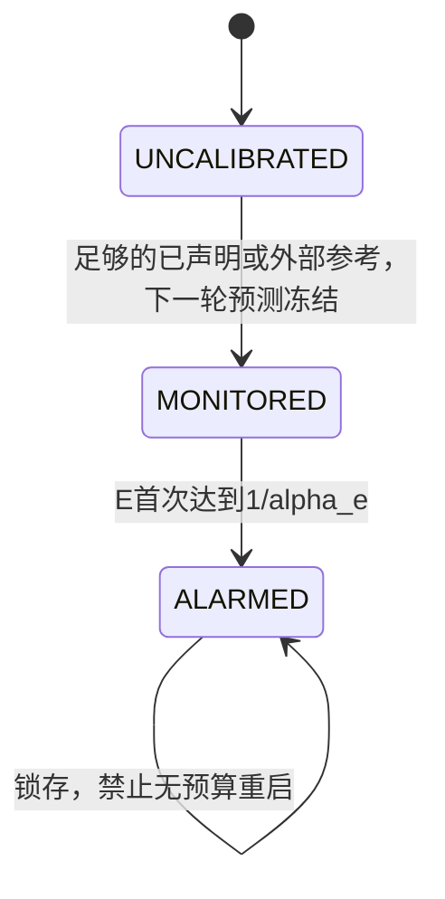

# 第四阶段：理论变量、训练代码和总体错误预算

本文件逐项对照 `STAGE3_THEORY.md`。**第三阶段标量仿射特例与真实训练不是同一个统计模型。** 本阶段加入显式可预测上下文，但没有把历史拟合升级为已证明的真实条件校准。

## 数学变量对应表

| 理论变量 | 第三阶段实现 | 当前训练实现或缺失项 |
| --- | --- | --- |
| 客户端 i、总数 N | 每条独立标量轨迹；聚合代理仅一个被监控客户端 | `client`、`args.clients`、`ErrorBudget.clients`；固定身份，不随参与人数变化 |
| 全局轮 t、总轮 T | `stress_validation.run_cell()` 的 `t`、`horizon=240` | `round_id`、`args.rounds`，先导 T=20 |
| 参与集合 S_t | 标量测试每轮参与 | `train_round.selected`，来自更新前的 `select_participants()`；`ClientController` 为所有客户端先冻结预测，不要求其一定参与 |
| 过程实际下注次数 | `BatchEProcess` 每轮累计一次 | `BoundedMeanEProcess.t` / 日志 `process_steps`；与全局轮数不同，预热、缺席、未校准和已停止客户端不下注 |
| F_(t-1) | 过去目标、独立参考、固定协议/RNG 状态等信息 | 不以一个 Python 对象表示；对应轮前服务器状态、历史记录、已揭示随机性和记录。代码时序只能支持可测性审查，不认证概率模型 |
| G_t=F_(t-1)∨sigma(C_t,S_t) | 预先给定的外生 `context` 路径和参与信息 | 不以一个对象表示；`RoundContext` 和更新前已知的参与规则扩展过去信息。当前目标更新不在此信息中 |
| C_t / c_t | `context`：0、±1 或线性时间路径，事先设计 | `RoundContext.value`：见下一节；从轮前全局模型计算；有反馈，**不是已证明外生的协变量** |
| 当前更新 Δ_(i,t) | 标量 `clean` / 攻击后 `observed` | `local_train()` 返回的 CPU `update` 状态差；攻击后再提取监测特征 |
| 特征 h(Δ) | 单个有界标量，方向固定 | `update_features()`：16 个固定块均值经 tanh，再除以 sqrt(16)，向量范数≤1；16 维不等于16个独立检验 |
| 预测方向 v_(i,t) | 固定标量方向 1 | `Prediction.direction`：`ContextualHistory.predict()` 用参考前半部分均值归一化构造。不是由当前更新选择 |
| 观测 X_(i,t) | `observed` | `Prediction.score(features)` 的有向内积，数值舍入时裁剪至 [-1,1]；日志 `score` |
| 真条件均值 m_t=E[X_t\|G_t] | 生成机制中的 `mean`，只用于评估包络 | **真实训练不可观测，没有对应的已知 Python 数值。不能将预测值当成真条件期望** |
| 预测 muhat_t | 双锚点 `predict(context)` / `centers` | `Prediction.mean` / 日志 `prediction_mean`，显式使用 `theta[0]+theta[1]*context` 并投影到 [-1,1] |
| 锚点预测 muhat_A(c)、滚动预测 muhat_R(c) | `predict(context)`、`rolling_conditional` | 真实训练的 ridge 预测不是锚点证书模型；没有直接部署这两个已证明特例 |
| θ_0、θ_1（真实正常规律） | DGP 的 `intercept`、`slope` | **未知，不存在已验证的对应真值** |
| 拟合 θhat_0、θhat_1 | 由 `low`、`high` 插值得到的系数 | `ContextualHistory.predict()` 中 `theta`，日志 `theta0/theta1`；由参考后半部分有向分数拟合，固定 ridge=0.001 |
| 误差界 b_t | `bounds`：固定、滚动或保守包络 | `Prediction.mean_error_bound`。`assumed` 模式由 `--mean-error-bound` 给定，未认证；`conservative` 为 1+abs(muhat)，确定性有效但无功效 |
| 支持端点 A_t、B_t | 观测支持 [-1,1] | `BoundedMeanEProcess.lower_bound=-1`、`upper_bound=1`；`score()` 有界性来自特征范数和单位方向 |
| 区间宽 R_t=B_t-A_t | 2 | `upper_bound-lower_bound`，为2。不要与实验次数混淆 |
| 条件次高斯代理 σ_t²=R_t²/4 | 1，未用实际小噪声缩窄 | `BoundedMeanEProcess.variance_proxy=1`；补偿项 `.5*variance_proxy*lambdas**2` |
| 下注 a=sλ、正值网格 λ | `BatchEProcess.lambdas`，默认正负五对 | 每个 `BoundedMeanEProcess.lambdas` 相同且在初始化时固定，未根据当前更新选择符号或幅度 |
| 单步指数因子 Q_t^a | 批量 log 更新中每轮增量的指数 | `exp(monitor.last_log_factors)`；该字段在真正下注后才存在 |
| 单个累计 L_t^a | `BatchEProcess.log_components` 的指数 | `exp(monitor.log_components)`；没有在漂移、缺席或每轮重置 |
| 混合权重 w_a | 隐式等权 `mean(exp(...))` | `logmeanexp(log_components)`，等价固定权重 1/10；不是每轮重新挑选表现最好的下注 |
| 混合 E_t | log-mean-exp 后的指数 | `exp(monitor.log_e)`，日志 `log_e`；未启动检验的客户端日志为缺失，不表示“正常” |
| 报警时间/阈值 | 首次跨越 1/alpha_e | `monitor.alarmed` 锁存，`ClientState.ALARMED`；阈值 `log(1/monitor.alpha)` |
| 正常参考 B_(i,t-1) | 独立生成的正常锚点及参考服务 | `ContextualHistory.references`，含特征、当时上下文、来源；外部来源文本不认证真实性，预热来源标为仅协议声明 |
| 原始参考 Y_j、c_j | `refs`、`contexts`，独立参考样本均值块 | 当前训练是参考记录的特征及其上下文；**不是第三阶段的独立标量锚点抽样实验** |
| 校准样本数 n、均值 Ybar | `anchor_samples_per_context=1024`、`low/high` | 默认至少8条历史，前4条定方向、后4条拟合上下文。不存在每端1024个独立锚点；不能调用其证书冒充真实界 |
| epsilon_A（锚点误差） | `fixed_history_bound()`、`eps_fixed` / `eps_anchor_rolling` | **未在真实训练认证或使用该锚点证书** |
| 滚动窗口 W_t、残差 R_j | `refs/contexts` 与 `rolling-predict(mean_context)`；`ExternalCleanWindow` 提供准入契约 | 真实监控期间不滚动接纳目标更新；隔离区不是 W_t；本阶段没有把第三阶段滚动定理接入真实训练 |
| 真残差均值 r(c)=m(c)-muhat_A(c) | 生成机制的 `mean-predict(context)`；仅理论/评估可知 | 真实训练未知，不能由单个已观察残差代替其条件期望 |
| epsilon_R | `rolling_history_bound()` 的 Hoeffding/窗口并集部分 | **无真实独立滚动参考服务，未认证** |
| delta_A、delta_R | 固定策略全给锚点，滚动策略各取一半 | 真实训练仅预留每检验 delta；没有声称已经有概率≤delta的真实校准证书 |
| 校准失败停止时刻 | 理论证明中首次条件包络失效之前停止 | 只用于证明；真实 m_t 未知，因此代码不能直接识别该时刻。`ALARMED` 不是校准失败停止时刻 |
| alpha_e / alpha_(e,i,k,j) | `.9*alpha`，单个轨迹检验 | `ErrorBudget.alpha_e`，每个客户端/独立特征检验/实验组合分别分配 |
| delta / delta_(i,k,j) | `.1*alpha` | `ErrorBudget.delta_calibration`，预留校准失败概率；实际失败界仍需证明 |
| 校准预算比例 rho | `calibration_budget_fraction` | `ErrorBudget.calibration_fraction`，当前.1，初始化固定 |
| alpha_global | 第三阶段各标量评估的目标 alpha | 本阶段 `ErrorBudget.alpha_global`，先导对预定36组合整体指定 .05 |
| 特征检验数 K、实验组合数 J | 模拟分别评估策略和alpha，不声称这些并行组成一个最小alpha家族 | `ErrorBudget.features`、`runs`；当前控制器仅支持 K=1，J=36 |

## 历史方向预测与条件上下文的真实区别

旧 `ClientHistory.predict()` 将可信特征均值归一化为方向，并用同批历史的投影平均作 muhat；没有任何 c_t 输入。这不是第三阶段的条件仿射模型，历史可预测不等于条件均值误差被控制。

新真实训练使用 `ContextualHistory`，并在每轮任何客户端训练之前构造

\[
c_t=\tanh\log\frac{rms(w_{t-1})+10^{-12}}{rms(w_0)+10^{-12}}\in[-1,1].
\]

它只使用轮前已知模型；`RoundContext` 与所有预测快照在更新前冻结。方向从前半正常参考构造，后半记录用于拟合 muhat=clip(theta0+theta1*c_t,-1,1)。样本拆分消除同一条记录同时定方向和拟合均值的直接重用，但不消除联邦模型轨迹导致的时间依赖。

这个上下文可预测但有内生反馈；是否足以解释 Non-IID、漂移或攻击影响尚未知。真实训练没有受控 ±1 锚点、稳定仿射真均值、独立正常参考或已知系数误差界。因此 **理论模型与真实代码只有变量/数据流的对应，尚没有真实条件校准定理的对接；不得声称真实条件漂移适应能力已成立。**

日志记录 theta、方向、上下文值/来源/秩、外推标志、muhat、b、X、下注次数、状态和实际权重。`monitoring_audit.replay_client_logs()` 可从这些量复算指数过程，但数值复算通过不证明条件假设。

## 三种客户端状态与准入策略

`MONITORED` 表示参考足以建立预测并启动检验，**不是 NORMAL，也不是已证明校准**；其 `calibration_status` 单独区分 `ASSUMED_NOT_CERTIFIED` 与保守确定性包络。全系统没有 NORMAL 状态。

| 未校准策略 | 接纳规则 | 全部未校准时 | 正常参考来源 |
| --- | --- | --- | --- |
| defer | 未校准权重0；已监测且未报警者按样本数分配 | 服务器保留1，可能一直没有全局学习 | 不从目标更新产生参考 |
| capped | 每个未校准客户端≤.02，未校准组总量≤.2；其余由合格者或服务器保留 | 十个等量客户端各.02，服务器保留.8 | 不从未报警目标产生参考 |
| clean-warmup | 必须显式声明前8轮无攻击；预热结束后有足够记录者下一轮才 MONITORED | 预热阶段可正常聚合，但状态仍 UNCALIBRATED | 仅指定预热阶段显式接纳；来源是控制实验假设，不是检测器认定 |

ALARMED 永远权重0；全拒绝为服务器 no-op。受限权重用 `server_weight` 保留剩余质量，不能再将少量客户端权重独自归一化到1。仅降低权重不等于限制任意大更新的破坏，当前没有声称 Byzantine 鲁棒性。

所有被观察更新先进入隔离区。普通 `observe()` 永不添加正常参考，包括未报警更新。只有单独的 `admit_declared_warmup()` 在预声明阶段被显式调用；监测开始后它会拒绝准入。真实部署若不能排除预热期攻击，就不能把这些记录当作已知正常数据。

## 总体错误预算与推导

对于预先固定的 N 个客户端、K 个独立报警特征过程、J 个实验组合，设 rho 为校准预算比例：

\[
\alpha_{e,i,k,j}={(1-\rho)\alpha_{global}\over NKJ},\qquad
\delta_{i,k,j}={\rho\alpha_{global}\over NKJ}.
\]

若每个检验的条件包络在全监控期间以失败概率≤delta成立，且指数过程在包络有效时满足第三阶段的可预测性/有界条件，则通过有效停止过程、Ville 和失败事件并集：

\[
P(\exists\text{正常客户端被报警})
\le\sum_{i,k,j}(\alpha_{e,i,k,j}+\delta_{i,k,j})
\le\alpha_{global}.
\]

客户端、特征或实验组合可以相关，不要求它们彼此独立；但各自的条件假设必须相对于完整过滤族成立。预热正确性假设本身不由错误预算认证，攻击漏检/准入损害也不属于误报控制。

默认单次运行 N=10、K=1、J=1、alpha_global=.05、rho=.1 时，每客户端 alpha_e=.0045、delta=.0005。36组合先导使用 J=36，alpha_e=.000125、delta≈.000013888889，阈值8000；360个检验的序贯预算总和 .045、校准预算总和 .005。

16维特征向量被投影成**一个** X，因此 K=1。十个固定下注的有效混合也仍是一个过程，不再分10份。若另增范数、多个独立方向并各自报警，则需对 K 继续分预算，或先证明其合并 e-process；当前控制器对 K!=1 会报错，避免静默漏分。回归参数和上下文维数本身不是独立检验数量。

参与率变化、缺席、UNCALIBRATED 不触发预算回收或增加。ALARMED 后不重启过程；先导运行器禁止已启动家族无状态重跑。人工新建输出目录或额外实验仍必须新分配预算，不能重复消费同一 alpha_global。

**以上是带前提的误报定理，不是当前真实模型的保证。** 本阶段 `assumed` 模式未证明 P(包络失败)≤delta；预留了数字不能使该不等式自动成立。只有保守包络具有不依赖真实均值模型的确定性覆盖，但它没有有用检测功效。
